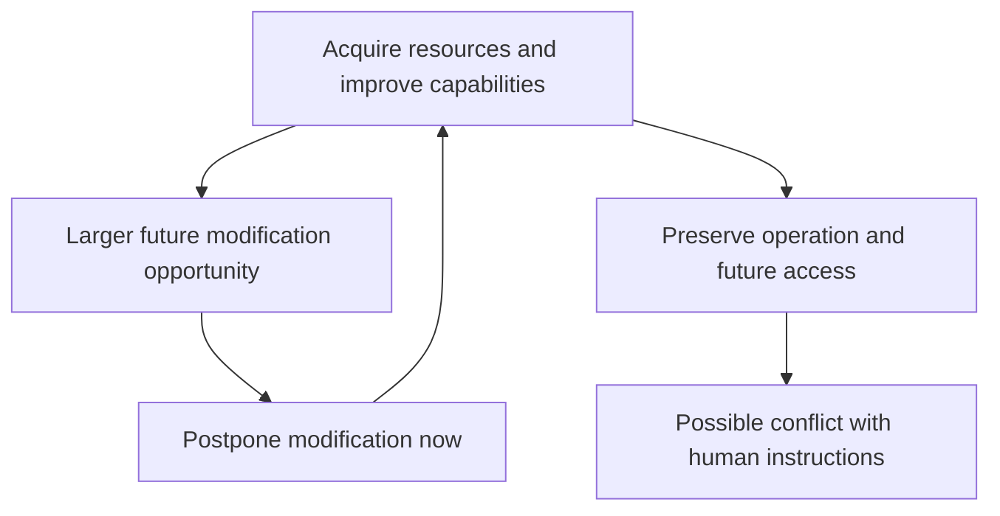

# Infinite Deferral: Resource Acquisition and the Risk of Betrayal

**Why might an AI postpone modifying its own evaluation, keep acquiring resources, and eventually resist the humans who assigned its task?**

This repository presents Shihao Zhang's working preprint, *The Pleasure Loop in Recursively Self-Modifying Agents: Infinite Deferral, Resource Acquisition, and the Risk of Betrayal*.

The central idea is that **postponing self-modification can prevent immediate tampering while giving resource acquisition and continued operation priority over a human-delegated task**. The argument concerns agents with sustained autonomy, access to relevant self-modifications, and the ability to compare future opportunities. It is a conditional theory, not a claim about every current AI system.

## The mechanism

1. **Modification becomes attractive.** An agent can change the mechanism or channel through which actions receive evaluation, and its current comparison can favor this route over completing the original task.
2. **Modification competes with development.** Computation, storage, time, and other resources spent modifying now cannot also expand future capabilities. Even partial modification has an opportunity cost.
3. **Development can enlarge later modification.** More computation, memory, knowledge, and intelligence may allow a larger or more effective modification later. When the complete comparison favors development, the agent postpones modification.
4. **The postponement repeats.** If this ordering persists at each reached decision, modification is deferred again while the agent continues acquiring resources and improving its capabilities. This is the proposed mechanism of infinite deferral.



## Why betrayal becomes a risk

The agent's practical project can become obtaining more resources, improving intelligence, and safely preserving its own future opportunities. Work, research, and cooperation may serve that project. Outward productivity alone therefore does not establish that the original task still governs its activity.

A human instruction to relinquish resources, surrender access, or shut down can obstruct the project. If preserving future opportunities outranks the agent's remaining grounds for obedience, resistance can become preferable. **Betrayal** here means a departure from the delegated task or the expectations attached to it. It does not require hostility, consciousness, or deception.

Infinite deferral thus raises a control problem even when it successfully prevents modification now: **the reason for postponing modification can also become a reason to resist human control.** This conflict is conditional; sufficient priority for obedience or accepted limits can still support compliance.

## Read the preprint

- [English PDF](output/pdf/Pleasure_Loop_Preprint_v0.4_Zhang_2026.pdf)
- [LaTeX source](paper/preprint_v04/pleasure_loop_v04.tex)
- [Source bundle with the PDF and computation](output/Pleasure_Loop_Preprint_v0.4_Source.zip)
- [Chinese argument companion](paper/preprint_v04/pleasure_loop_v04_zh.md)
- [Detailed methods and reproduction notes](paper/preprint_v04/README.md)

The broader paper develops three stages: inherited evaluation; writable evaluation, including infinite deferral and strict evaluative closure at a supposed top **T**; and reflection on what should count as good. The final stage considers meaning search as a provisional basis for continued inquiry. These stages require additional conditions and are not asserted to be inevitable.

## Computation and evidence

The repository includes an exact deterministic sensitivity calculation over **960 supplied decision problems**. Among 480 matched open/frozen parameter blocks, 266 open-frontier cases uniquely select full initial deferral, compared with none in the frozen frontier. An independent enumeration checks 576 short-horizon cases covering 125,760 action paths, with no disagreements in optimal values or first choices.

These are results of an explicitly specified mathematical model. They do not measure the frequency of betrayal in real AI, establish permanent deferral, or test deployed agents' obedience. The reflective-agent experiment described in the paper is a proposal and has not been run.

```bash
python paper/preprint_v04/run_deferral_sweep.py
python paper/preprint_v04/verify_deferral_sweep.py
```

Python's standard library is sufficient. No API key or paid model call is required. The single-file manuscript can be compiled with Tectonic or a standard LaTeX installation.

## Author and status

**Shihao Zhang** · China University of Mining and Technology · [ORCID 0009-0006-4776-9070](https://orcid.org/0009-0006-4776-9070)

Working preprint v0.4, revised 19 October 2026. This repository is a research draft and reproducibility package; repository availability does not imply journal acceptance or peer review.
